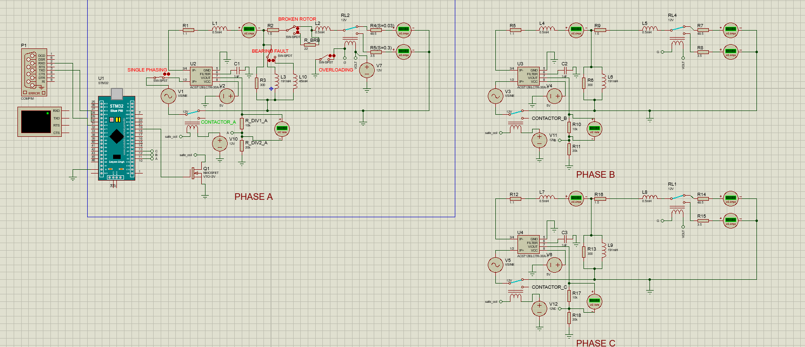
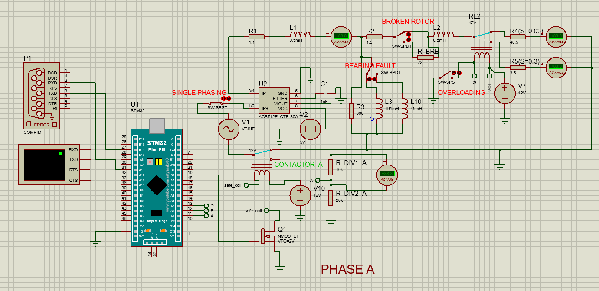
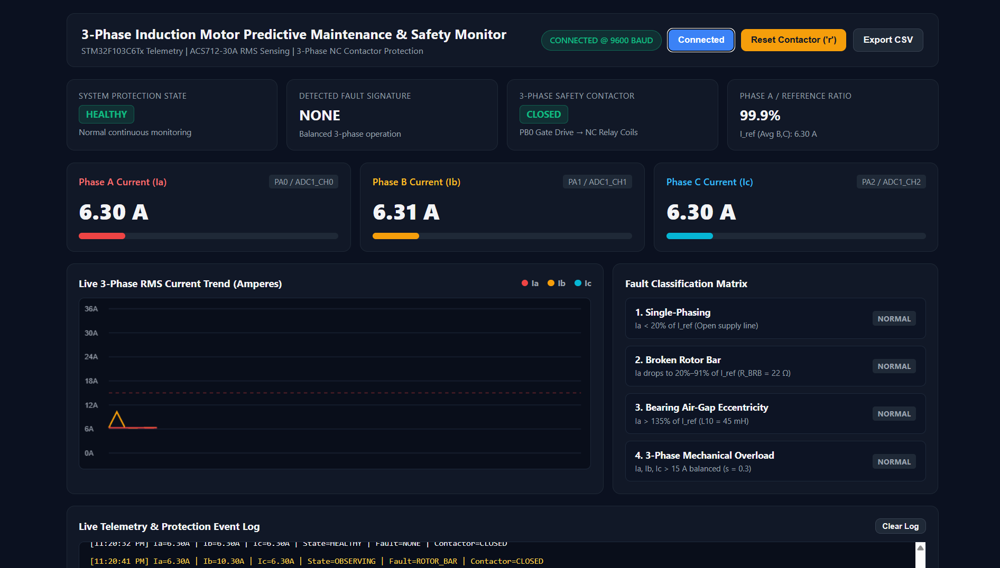

# 3phase-induction-motor-predictive-maintenance
I have made this project in my summer break to understand microcontrollers

Real-time embedded condition monitoring, multi-fault classification, and automated safety isolation for a 3-phase squirrel-cage induction motor, built with **STM32F103C6Tx**, **Proteus 8 VSM**, and a live **WebSerial HTML5 Dashboard**.

## System Architecture

- **Motor & Fault Model (Proteus 8):** Per-phase R-L equivalent circuit (`325 V` peak / `230 V` RMS, `50 Hz`, `0° / 120° / 240°` phase shifts) with switchable faults:
  1. **Single-Phasing** (`SW-SPST` open supply line on Phase A)
  2. **Broken Rotor Bar** (`R_BRB = 22 Ω` series resistance switched into Phase A rotor branch)
  3. **Bearing Air-Gap Eccentricity** (Phase A magnetizing inductance shifted from `191 mH` to `45 mH`)
  4. **3-Phase Mechanical Overload** (`12 V` relays switching rotor slip load from `s = 0.03` to `s = 0.30`)
- **Current Sensing:** Three `ACS712ELCTR-30A-T` Hall-effect sensors (`66 mV/A`) scaled via matched `10 kΩ / 20 kΩ` voltage dividers (`29.4 mV_rms / A_rms` at `PA0`, `PA1`, `PA2`).
- **Embedded Firmware (`STM32CubeIDE`):** `64 MHz` SYSCLK, `600 Hz` `TIM3`-triggered interleaved `ADC1` + `DMA` capture (`200 Hz/channel` across `5` full `50 Hz` cycles), DC-offset-corrected True-RMS calculation, phase-asymmetry classifier (`Ia / I_ref`), `3`-cycle (`1.5 s`) transient filter, and `PB0` NMOSFET gate drive for 3-phase NC safety contactors.
- **Supervisory Dashboard (`dashboard.html`):** Zero-dependency WebSerial interface (`9600 baud` over virtual COM bridge) featuring live RMS gauges, real-time current trend plotting, fault signature cards, CSV telemetry export, and remote contactor reset (`'r'`).

## Experimental Results

| Operating Condition | `Ia` (A) | `Ib` (A) | `Ic` (A) | Ratio `Ia / I_ref` | Firmware Action |
| :--- | :---: | :---: | :---: | :---: | :--- |
| **Healthy Baseline** (`s = 0.03`) | `6.30–6.32` | `6.27–6.30` | `6.27–6.32` | `1.00` | `HEALTHY` (`CLOSED`) |
| **Broken Rotor Bar** (`R_BRB = 22 Ω`) | `5.30` | `6.29–6.30` | `6.30` | `0.84` | `TRIP: ROTOR_BAR` (`OPEN`) |
| **Bearing Eccentricity** (`L10 = 45 mH`) | `16.19–16.33` | `6.29–6.30` | `6.30` | `2.58` | `TRIP: ECCENTRICITY` (`OPEN`) |
| **3-Phase Overload** (`s = 0.30`) | `30.95–33.85` | `31.13–34.11` | `31.19–34.17` | `0.99` | `TRIP: OVERLOAD_3PH` (`OPEN`) |
| **Single-Phasing** (Phase A Open) | `0.00` | `6.29–6.30` | `6.29–6.30` | `0.00` | `TRIP: SINGLE_PHASING` (`OPEN`) |

## How to Run

1. Open `Simulation_Proteus/induction.pdsprj` in **Proteus 8 Professional** and verify `U1` (`STM32F103C6`) points to `Firmware_STM32/Debug/induction.hex`.
2. Create a local virtual COM bridge (e.g., `COM1 <-> COM2`) and assign one port to `P1` (`COMPIM` at `9600 baud`) in Proteus.
3. Click **Play** in Proteus, open `Dashboard_WebSerial/dashboard.html` in Chrome, Edge, or Brave, click **Connect Serial Port**, and select the paired COM port.

📄 **[Read the Full Project Documentation (PDF)](documentation/induction.pdf)**
